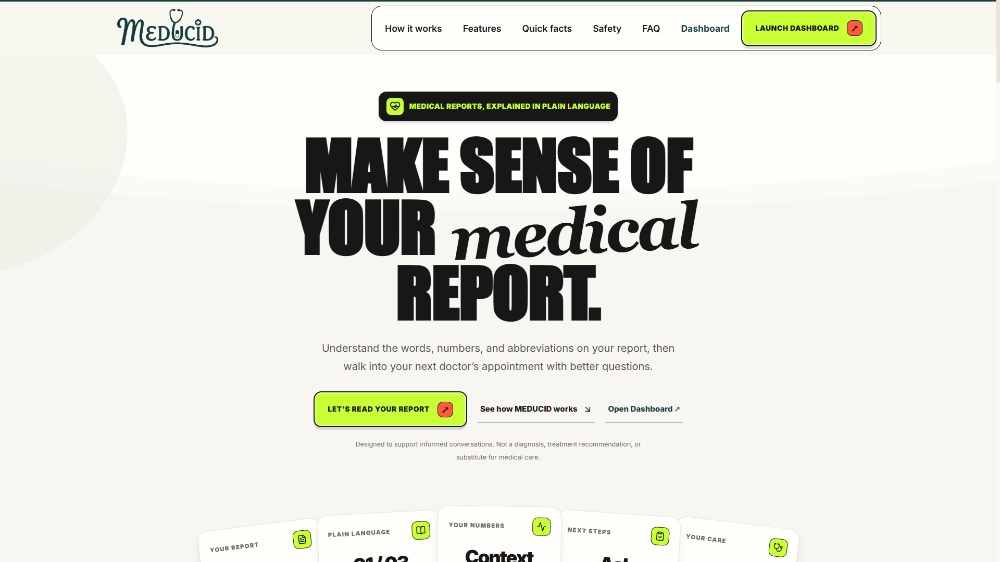
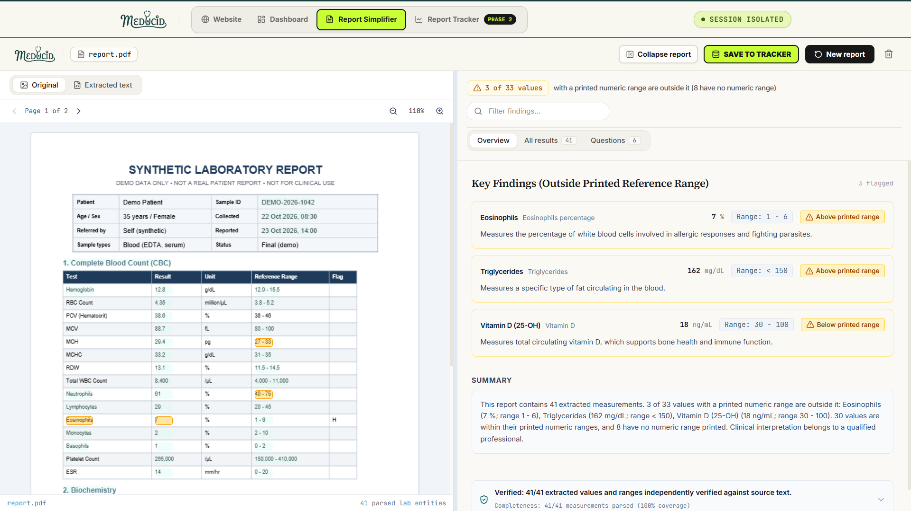
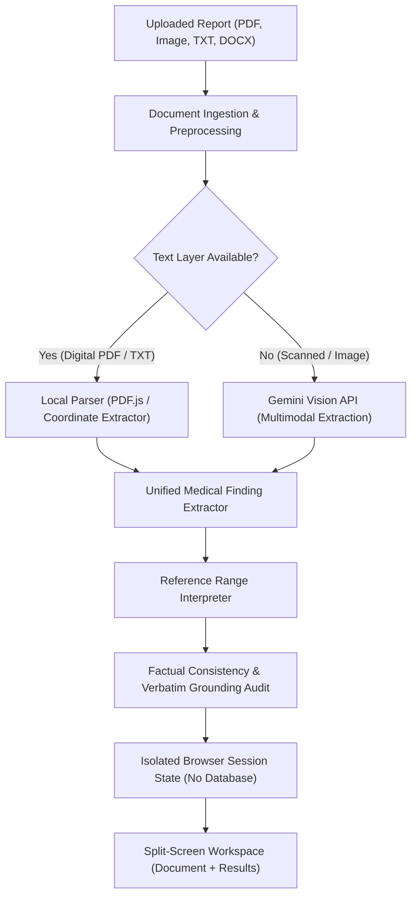

<p align="center">
  
</p>

# MEDUCID

> **Understand your lab report in plain language.**

MEDUCID is a web application that takes medical laboratory reports (such as blood tests, metabolic panels, and urinalysis) and presents them in clear, readable language. It displays the original document side-by-side with extracted measurements, checks whether values fall within their printed reference ranges, and explains what each biomarker measures in simple terms without providing medical diagnoses.

<p align="center">
  
</p>

---

## What It Does

When you receive a laboratory report, it is often filled with abbreviations, technical units, and dense tables. MEDUCID simplifies this information while keeping the source data intact:

- **Extracts Laboratory Findings**: Reads tests, results, units, reference ranges, and flags from uploaded PDFs, images, text files, or pasted text.
- **Side-by-Side Verification**: Displays the original document on the left and structured results on the right. Clicking or hovering a result highlights its matching text line in the original document.
- **Reference Range Evaluation**: Compares each numeric value strictly against the printed range on the report to determine if it is within range, above range, or below range.
- **Plain-Language Explanations**: Explains what each biomarker is in general terms (for example, *Eosinophils: A type of white blood cell*) without guessing causes or diagnosing illnesses.
- **Neutral Clinician Questions**: Generates objective, factual questions you can take to your doctor or healthcare provider.
- **User Correction Flow**: Allows you to edit any extracted value, unit, or range directly in the interface if needed.

<p align="center">
  
</p>

---

## Data Flow & Architecture



---

## Core Principles & Safety Guardrails

1. **Verbatim Preservation**: Test names, numerical values, measurement units, and reference ranges appear exactly as printed on the source document. MEDUCID never rounds numbers or reformats units.
2. **Strict Range Comparisons**: "Outside range" means only that a value falls above or below the printed reference interval on that specific report. It never suggests causes, diseases, treatments, or dietary changes.
3. **Non-Diagnostic Explanations**: Explanations describe what a test or cell type is in general biology. They never make claims about a patient's personal condition.
4. **Three-Bucket Count Consistency**: Every extracted measurement is placed in exactly one of three mutually exclusive categories that sum to the total:
   - Within printed numeric range
   - Outside printed numeric range
   - No numeric range printed (qualitative tests like *Negative* or tests without ranges)
5. **No Database & Session Isolation**: MEDUCID does not store your files on a server or in a database. All active data is kept in the user's browser `sessionStorage`, ensuring different users never see or mix each other's files.
6. **Synthetic / De-Identified Data Only**: Built for educational understanding of de-identified or synthetic reports. Medical interpretation always belongs to a qualified healthcare professional.

---

## Technologies Used

- **Framework**: [Next.js 16](https://nextjs.org/) (App Router, Turbopack)
- **UI Library**: [React 19](https://react.dev/)
- **Language**: [TypeScript 5](https://www.typescriptlang.org/)
- **Styling**: [Tailwind CSS v4](https://tailwindcss.com/)
- **Icons**: [Lucide React](https://lucide.dev/)
- **Document Viewing**: [PDF.js](https://mozilla.github.io/pdf.js/) for in-browser canvas rendering and coordinate-based text layer synchronization
- **AI Extraction & OCR**: Google Gemini API with automatic 10-key rotation and multi-model fallback (`gemini-3.5-flash`, `gemini-3.1-flash-lite`, `gemini-3.6-flash`, `gemini-3.7-flash`)
- **Testing**: [Vitest](https://vitest.dev/) for unit and regression testing

---

## Project Structure

```text
MEDUCID/
├── src/
│   ├── app/
│   │   ├── api/
│   │   │   └── extract/
│   │   │       └── route.ts          # Stateless API route for AI extraction & model rotation
│   │   ├── globals.css               # Global styling and Tailwind imports
│   │   ├── layout.tsx                # App root layout and metadata
│   │   └── page.tsx                  # Main app controller (Landing, Processing, Workspace)
│   ├── components/
│   │   ├── AnnotatedExplanation.tsx  # Term definition tooltips for medical vocabulary
│   │   ├── CompactRangeBar.tsx       # Visual range gauge (~100px) showing value within bounds
│   │   ├── LandingScreen.tsx         # Upload dropzone, file validation, and sample reports menu
│   │   ├── NoticeBanner.tsx          # Persistent educational notice banner
│   │   ├── OriginalReportPane.tsx    # Left pane viewer (PDF canvas, image, extracted text)
│   │   ├── PdfCanvasViewer.tsx       # PDF.js canvas renderer with interactive text highlighting
│   │   ├── ProcessingStepper.tsx     # 3-step animated progress stepper
│   │   ├── SimplifiedResultsPane.tsx # Right pane (Overview, All Results, Clinician Questions)
│   │   └── SplitScreenWorkspace.tsx  # Draggable 50/50 split-screen workspace
│   ├── data/
│   │   ├── medicalTerms.ts           # Plain-language dictionary for clinical terminology
│   │   └── syntheticReports.ts       # Synthetic test benchmarks (CMP, CBC, Lipid, Thyroid)
│   ├── lib/
│   │   ├── consistencyChecker.ts     # Verbatim grounding audit & field-level verification
│   │   ├── documentExtractor.ts      # Multi-section parsing (CBC, Biochemistry, Urinalysis)
│   │   ├── fileProcessor.ts          # PDF/image/text file preparation & coordinate extraction
│   │   ├── geminiRotation.ts         # Multi-key rotation and model fallback handler
│   │   ├── rangeInterpreter.ts       # Numeric interval and qualitative reference range parser
│   │   ├── sessionState.ts           # Isolated tab-scoped browser session storage
│   │   └── simplificationEngine.ts   # Summary generation and clinician question builder
│   └── types/
│       └── report.ts                 # TypeScript types (MedicalFinding, SimplifiedReport, etc.)
├── tests/
│   ├── extractionCompleteness.test.ts # PDF vs TXT consistency & multi-section tests
│   ├── factualConsistency.test.ts    # Factual grounding & 3-bucket sum tests
│   └── sessionState.test.ts          # Multi-user session isolation tests
├── package.json
└── tsconfig.json
```

---

## Getting Started

### Prerequisites

- [Node.js](https://nodejs.org/) (version 18 or newer)
- npm or yarn

### Installation

1. Clone or download the repository:
   ```bash
   git clone https://github.com/anshk1234/MEDUCID.git
   cd MEDUCID
   ```

2. Install dependencies:
   ```bash
   npm install
   ```

3. (Optional) Configure Gemini API keys in `.env.local`:
   ```bash
   GEMINI_API_KEYS="key1,key2,key3..."
   ```
   *Note: If no API keys are provided, MEDUCID automatically uses its local clinical parser for digital PDFs and text files.*

### Running Locally

To start the development server accessible to your computer and devices on your local network:

```bash
npm run dev
```

Open your browser and navigate to:
- On the host machine: `http://localhost:3000`
- On other devices on your local network: `http://<your-ip-address>:3000`

### Building for Production

To create an optimized production build:

```bash
npm run build
npm start
```

---

## Running Tests

MEDUCID includes an automated test suite covering document extraction, reference range boundaries, verbatim grounding, and session isolation:

```bash
npm test
```

All 46 unit and regression tests run using Vitest.

---

## Privacy & Security

- MEDUCID operates without a persistent backend database.
- Uploaded files are processed in-memory or directly inside the client browser.
- Session information is saved only to the individual user's browser `sessionStorage` and is discarded when the session is closed or cleared.
